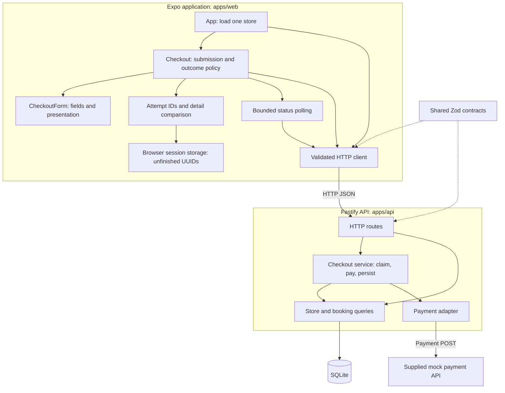

# Architecture and application boundaries

The application implements a single-store checkout with booking persistence and a mock payment integration. It uses Expo/React Native for the client, Fastify for the API and SQLite for storage. The [challenge brief](https://you.ashbyhq.com/Bounce/assignment/5b7a5a3c-8a66-4d2a-a511-1bdabbbf3d42) and [payment API documentation](https://fullstack-challenge-api.usebounce.io/v1/docs) provide the source requirements and provider contract. The wider architecture below describes possible extensions of this application.

## Current implementation



The coordinator holds consequential decisions near the entry point. Form fields stay local and mounted through failure/pending states. The backend owns price and quantity limits, claims attempts atomically, and keeps network calls outside database transactions. [Design](design.md) contains the sequence/state diagrams and response matrix; [operations](operations.md) explains the logs and unresolved outcomes.

This is a single-process API with local SQLite, not a distributed payment system. UUID replay protection prevents this API from issuing another provider call for an existing attempt. It cannot provide missing provider idempotency or establish exactly-once charging across network/database failures.

## Web, iOS and Android in one Expo application

`apps/web` already contains an Expo/React Native application with React Native Web for the browser. The name identifies the verified target, not an architectural restriction. The intended native expansion uses this same workspace and application, rather than separate implementations of the checkout screen.

| Concern | Shared across the three targets | Platform boundary |
| --- | --- | --- |
| Checkout UI | Coordinator, form, styles, field validation and state transitions | Keyboard behavior, safe areas, accessibility and screen sizing require device verification |
| Checkout policy | UUID generation, comparison of non-card details, retry/replay rules, integer cents | Platform lifecycle must trigger status recovery without automatic payment retries |
| HTTP contracts | API clients and response validation; the backend remains authoritative | Configure a device-reachable HTTPS URL; a phone's loopback address is the phone, not the development machine |
| Unfinished attempt storage | Persist only checkout/attempt IDs, and clear after success/decline | Browser tab session storage today; a future native adapter must retain unfinished IDs across app restarts |
| Payment collection | Current synthetic-card form supports the mock payment flow | Production needs a provider-supported tokenization integration, with web/native collection adapters |

When native work begins, a rename to `apps/client` would make the workspace's purpose clearer. The current workspace name can remain until native delivery begins. The eventual layout would be:

```text
apps/client/                     # future rename of the current Expo workspace
  App.tsx
  app.json                      # native configuration; config plugins when needed
  src/components/               # shared checkout and form
  src/api/                      # shared typed clients
  src/lib/                      # shared retry policy and small platform adapters
    attempt-storage.web.ts      # browser tab session storage
    attempt-storage.native.ts   # future native unfinished-ID storage
  ios/                          # generated during native development/build
  android/                      # generated during native development/build
apps/api/                       # current Fastify backend
packages/contracts/             # shared TypeScript/Zod HTTP contracts
```

Per [Expo's Continuous Native Generation guidance](https://docs.expo.dev/workflow/continuous-native-generation/), native directories are generated from app configuration and config plugins. They belong beneath the Expo workspace; they are not separate application workspaces or places to manually duplicate React components. With absent native directories, EAS can generate them during builds. The repository's Expo guidance requires native customization through configuration/plugins.

Current `ios`/`android` scripts launch Expo for those targets; they do not establish a tested, signed native release. Before claiming native support, verify SDK 57 builds, safe areas, keyboard navigation, screen readers, network configuration and background/foreground recovery on both platforms. Native storage and restart recovery are currently absent; the browser storage helper becomes a no-op there. Do not assume browser tab/session semantics apply to app termination.

Keep components and policy local while there is one universal client. If another application genuinely needs them, extract presentational React Native components into a UI package and pure retry/price policy into a checkout package, with storage and networking supplied at the boundary. Do not share server repositories or let shared client calculations replace server validation.

## Identity and ownership

`checkoutId` identifies a booking intention; `attemptId` identifies one payment attempt. Different customers can submit identical details safely because their UUIDs differ. `checkoutSignature` compares non-card details only after an identity has been selected; the backend similarly compares a stored fingerprint after looking up the booking by ID. Neither signature is a global deduplication key, authenticated session, or ownership proof. It also contains customer details, so it must not be logged.

There is no authentication, account model or server-bound guest session. The status endpoint returns minimal information, but anyone possessing a checkout UUID can read that status. IDs consequently act as limited capabilities and deserve restricted log access; their randomness does not replace authorization. CORS is a browser-origin setting, not an authorization control.

Production would authenticate an account or issue a server-verified guest session and bind bookings to that principal. Both submission/replay and status lookup need ownership checks. An arbitrary device identifier or a client-generated session identifier cannot supply those checks. Card tokens and guest recovery credentials must also have their own appropriate storage and access policies.

## Deliberate scope limits

| Omitted capability | Current boundary | What a wider product needs |
| --- | --- | --- |
| Authentication and authorization | No user/guest ownership enforcement | Bind bookings to a verified principal and authorize every relevant operation |
| Store discovery and available capacity | One seeded store and configured quantity bounds | Availability/reservations and expiry; quantity limits are not capacity reservations |
| Wider booking lifecycle | Pending/confirmed records; no history screen, dates or check-in | Discovery, booking management and store operations based on product requirements |
| Payment reconciliation and refunds | Provider documents only a payment POST | Supported idempotency, lookup/webhooks, reconciliation, cancellation/refund workflows |
| Production card collection | Synthetic full card data travels through the development API | Tokenized provider integration and an assessed card-data handling boundary; redaction alone is insufficient |
| Notifications and receipts | Confirmation is an on-screen state | Reliable delivery triggered from committed booking changes |
| Native releases | Shared source and configuration; web verified | Native storage/lifecycle handling, device testing, signing and release pipelines |
| Production operations | Local SQLite and structured stdout logs | Hosting, secrets, access-controlled log retention, backups, readiness checks and measured alerts |

The demo's Start over action can create a second transaction after uncertainty. A larger product must reconcile the first payment before allowing another purchase. These boundaries define the work needed to expand the current single-store checkout into a production application.
