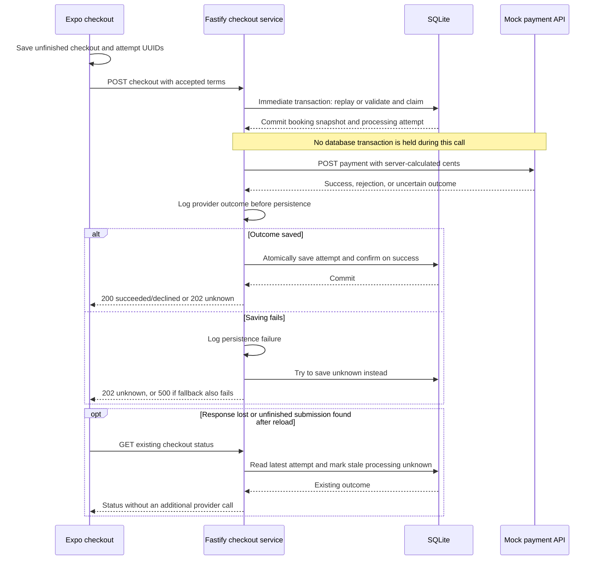
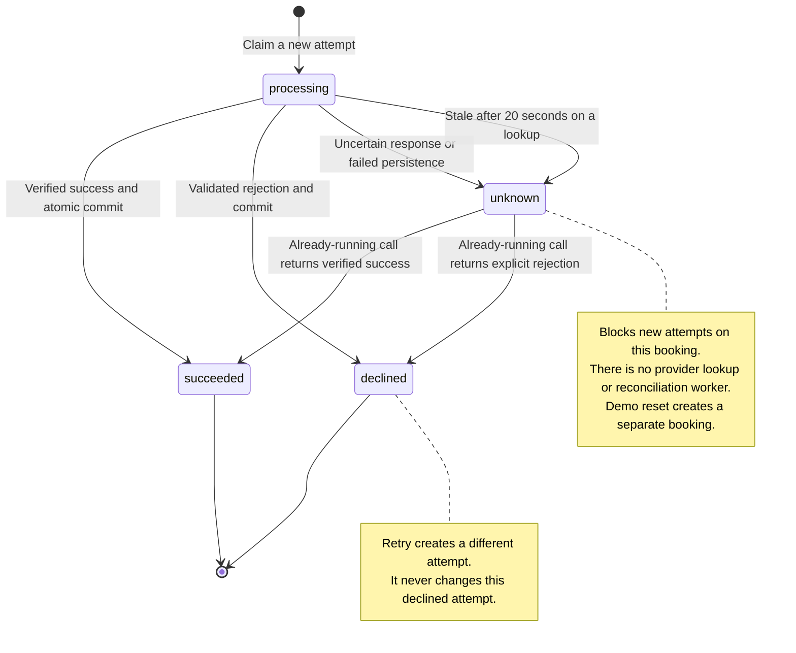

# Checkout design and API

## Flow and boundaries

The frontend loads one store, renders its bag price and bounds, and derives the displayed total from quantity × unit price. Name, email and card inputs use shared validation. Name/email are trimmed; card numbers accept digits and ordinary spaces, normalize to 13–19 digits and format in groups of four on blur. Errors appear after leaving a field and then update while correcting it.

`Checkout.tsx` is the coordinator: it owns store/quantity, accepted terms, attempt selection, submission, result/error handling and reset decisions. The interesting payment policy stays visible in this entry point.

`CheckoutForm.tsx` owns name/email/card state, touched fields, validation, keyboard focus and the rendered form. Its six props are `store`, `quantity`, `onQuantityChange`, `state`, `onBook(details)` and `onStartOver`. Passing normalized details on Book avoids lifting every keystroke into the coordinator. The form remains mounted during pending requests and failures so inputs survive; confirmation unmounts it and releases those values.

`lib/checkout-attempt.ts` selects identities and stores recovery IDs. Adjacent `components/checkout-recovery.ts` handles the polling interval, deadline and cancellation, reports processing and returns a terminal result; the coordinator applies that result or chooses the error state. `api/checkout.ts` verifies responses and distinguishes definite rejections from transport uncertainty. `CheckoutState` is exported by the coordinator and imported only as a type by the form, so sharing the view state introduces no runtime cycle. Adjacent styles keep presentation separate from the flow.

The backend checkout service follows three steps:

1. Inside a short immediate SQLite transaction, replay an existing attempt or validate current store terms, save the immutable booking snapshot and claim an attempt.
2. Call the payment provider outside the database transaction.
3. Atomically save the result and, on success, confirm the booking. If confirmation fails, retain an unknown outcome rather than invite another charge.

Routes handle HTTP shapes/statuses; repositories contain parameterized SQL. The service receives a provider function for isolated tests. Browser tests exercise the normal provider adapter against a local HTTP simulator.



An existing attempt takes the replay path before current terms are checked; it skips the provider call. A crash after claiming but before calling the provider is also uncertain on restart: the database cannot prove whether the call happened. Cancelling the browser request does not cancel or reverse a provider charge.

## HTTP interface

All errors use `{ "error": { "code": "...", "message": "..." } }`. Internal errors expose a generic message. Framework client errors such as malformed JSON, excessive request size and unsupported content types retain their 4xx statuses.

### GET /stores/:storeId

```json
{
  "id": "codys-cookie-store",
  "name": "Cody's Cookie Store",
  "currency": "USD",
  "checkoutItems": [
    { "id": "bag", "name": "Bag", "unitPriceCents": 590, "minQuantity": 1, "maxQuantity": 10 }
  ]
}
```

The contract requires exactly one bag item. Invalid identifiers return 400; missing stores return 404. The frontend has loading and Retry states and a ten-second request deadline; unvalidated response data never reaches the form.

### POST /checkout

```json
{
  "checkoutId": "11111111-1111-4111-8111-111111111111",
  "attemptId": "22222222-2222-4222-8222-222222222222",
  "storeId": "codys-cookie-store",
  "items": [{ "itemId": "bag", "quantity": 2 }],
  "expectedTotalCents": 1180,
  "currency": "USD",
  "name": "Reviewer Example",
  "email": "reviewer@example.com",
  "cardNumber": "4111111111111111"
}
```

The server rejects empty/multiple selections, unknown items, non-integer/out-of-range quantities and invalid customer/card data. It calculates the amount from SQLite. `expectedTotalCents` records displayed terms and is never trusted as the charge amount.

Before claiming a new attempt, a total/currency mismatch returns 409 `PRICE_CHANGED` with current store data. A quantity outside changed limits returns 400 `INVALID_CHECKOUT` with current store data. The client verifies that store, clamps the selection into its bounds, shows the new terms and requires another Book action. Ordinary definite validation rejections show their safe message without a status lookup.

```json
{
  "checkoutId": "11111111-1111-4111-8111-111111111111",
  "attemptId": "22222222-2222-4222-8222-222222222222",
  "status": "succeeded"
}
```

Statuses are `succeeded`, `declined`, `processing` and `unknown`. Success/decline return 200; processing/unknown return 202. An existing attempt returns its stored outcome without repricing or calling the provider. IDs reused with changed non-card details return 409 `REQUEST_CONFLICT`; the frontend attempts recovery because a payment may already exist.

### GET /checkout/:checkoutId

Returns the latest attempt's IDs and status, without customer/card details or a provider call. A malformed ID returns 400; a missing record returns 404. Checkout responses use `Cache-Control: no-store`.

Status GETs are read-only with respect to the payment provider. They can update local processing attempts to unknown after the stale threshold; they never initiate or retry a payment. These routes have no authentication or ownership checks; see [application boundaries](architecture.md#identity-and-ownership).

## Retry and recovery rules

| Situation | Client behavior | Provider behavior |
| --- | --- | --- |
| Double click or replay | Reuse the attempt IDs; an immediate request guard also prevents duplicate submission | Existing result/processing state is returned |
| Explicit decline, same non-card details | Keep the checkout ID, generate a fresh attempt ID; card may be changed | New payment attempt |
| Reload after an explicit decline | Empty form, with a new identity on the next Book; no previous-status lookup | Previous database records remain intact; no payment on reload |
| Non-card details edited after decline | Generate a new checkout and attempt | New accepted booking snapshot |
| Price or quantity terms changed before claim | Update the form, clear unused identity, require Book again | No payment until terms are accepted |
| POST response lost or unverifiable | Look up the existing checkout with GET | No automatic payment retry |
| Provider still processing, including after reload | Retain IDs, lock the form, poll status once per second within a 30-second recovery budget | No second payment POST |
| A status GET fails after processing was observed | Keep the form locked and retry reads within the same recovery budget | No second payment POST; expiry becomes unknown |
| Missing status record while original form remains mounted | Preserve IDs and unchanged details for a deliberate replay; lock edits | A late original request cannot race a separate identity |
| Missing status record after reload | Original details are unavailable; display unknown/reset | No blind replay of empty or changed details |
| Unknown provider outcome | Preserve IDs; offer explicit mock-only Start over | Old unresolved attempt remains protected |
| Confirmed success | Show “Booking Placed!”, clear card and recovery IDs; next reload starts fresh | Confirmed database records remain intact |

Browser tab session storage contains only UUID recovery IDs for unfinished submissions. Success and explicit decline clear those IDs; the mounted checkout retains its own identity for same-page Retry after a decline. Inputs stay in the mounted form. There is no global memory fallback: if browser storage is unavailable, reload recovery is unavailable, while same-page retry and recovery continue. Native restart recovery remains outside scope. If a saved unfinished payment is found to have declined, that result is shown once and its recovery IDs are cleared; original personal/card details are not restored.

An initial lookup failure is passed to the coordinator, which distinguishes a missing record that can be replayed with unchanged details from an unknown outcome. Once a status GET has reported processing, transient failures keep polling within the existing deadline. Unmount cancels requests and waits.

## Provider boundary and persistence

The default adapter calls `https://fullstack-challenge-api.usebounce.io/v1/payments` with `name`, `email`, integer-cent `amount`, `currency` and `card_number`. A success must contain a completed transaction with matching amount, currency and last four digits. Processing fees are metadata and do not increase the advertised charge.

The provider deadline is 15 seconds. Explicit validated 400 decline envelopes and documented 422 validation rejections permit retry. Timeouts, transport failures, unexpected statuses, invalid JSON and unverifiable transactions become unknown. There are no automatic provider retries. A processing record older than 20 seconds becomes unknown on the next status/replay check; a later valid provider result may still finalize it.

Bookings store customer details, accepted item prices/quantities, currency, total and confirmation state. Attempts store status, timestamps, local diagnostic codes or provider decline codes, and validated transaction metadata. The adapter discards extra transaction fields and decline prose. Full card numbers and card hashes are never persisted. Provider decline codes are arbitrary strings and are not copied into operational logs. A unique attempt ID and a partial unique index prevent concurrent unresolved attempts for one booking.

The mock provider exposes no documented idempotency keys, lookup or refunds. Local replay protection cannot guarantee exactly-once charging across a lost provider response or failed database write. The demo reset allows a separate checkout despite this uncertainty; production would need provider reconciliation or an equivalent recovery mechanism.

SQLite uses `better-sqlite3`, foreign keys and WAL mode. Startup applies filename-ordered SQL migrations transactionally and records them in `schema_migrations`. Seeds run once and do not reset edited prices. Database files are ignored by Git.

### Payment response matrix

Verified against the [provider documentation](https://fullstack-challenge-api.usebounce.io/v1/docs) and its [OpenAPI specification](https://fullstack-challenge-api.usebounce.io/v1/openapi.json) on 10 October 2026. It documents only 200, 400 and 422. Successful transaction status is a plain string in the schema; `completed` comes from the example. Requiring it, a nonempty transaction ID, matching payment terms, and a nonnegative integer fee are deliberate acceptance rules. An unfamiliar status cannot prove success. The processing fee remains metadata, not an additional customer charge.

All rows assume the attempt was already claimed. A saved success confirms the booking; every other outcome leaves it pending. Normal success/decline responses use HTTP 200; processing/unknown use 202. These are our API statuses, not a proxy of the provider's HTTP status.

| Provider response or boundary | Local outcome | Saved effect | Frontend and retry policy | Evidence |
| --- | --- | --- | --- | --- |
| 200: all required transaction metadata, `completed`, matching amount/currency/card suffix | `succeeded` | Save selected transaction metadata; confirm booking atomically | Confirmation; clear recovery IDs | [Adapter tests][adapter-tests], [HTTP tests][http-tests], [browser tests][browser-tests] |
| 400: string `detail` and nonempty `error_code`, at top level or inside `detail` | `declined` | Save decline code; booking stays pending | Generic failure; explicit Retry creates a fresh attempt | [Adapter tests][adapter-tests], [HTTP tests][http-tests], [browser tests][browser-tests] |
| 422: object with omitted `detail`, empty detail array, or valid validation entries | `declined`, `PAYMENT_VALIDATION_FAILED` | Save definite rejection | Same Retry policy; warn operationally because our server already validated input | [Adapter tests][adapter-tests], [integration/log tests][log-tests] |
| 200 with missing fields, unfamiliar status, wrong terms or invalid metadata; malformed 400/422 envelope | `unknown`, `INVALID_PROVIDER_RESPONSE` | Save uncertainty; block a fresh attempt on that checkout | Retain IDs; no automatic payment retry; demo-only reset | [Adapter tests][adapter-tests], [HTTP tests][http-tests] |
| Any other HTTP status, including other 2xx, redirects, 401/403, 429 and 5xx | `unknown`, `UNEXPECTED_PROVIDER_STATUS` when JSON parses | Save uncertainty | Same unknown policy; even a valid transaction-shaped body is insufficient | [Adapter tests][adapter-tests] |
| Invalid/empty/non-JSON response body | `unknown`, `INVALID_PROVIDER_RESPONSE` for JSON syntax errors | Save uncertainty | Same unknown policy; an HTTP status alone does not confirm payment | [Adapter tests][adapter-tests] |
| Network failure, connection loss, or redirect refused by fetch | `unknown`, `PROVIDER_NETWORK_ERROR` | Save uncertainty | Same unknown policy; never automatically repeat the provider POST | [Adapter tests][adapter-tests], [HTTP tests][http-tests] |
| Deadline/abort during connection or body reading | `unknown`, `PROVIDER_TIMEOUT` | Save uncertainty | Same unknown policy; aborting a local fetch does not prove the charge was cancelled | [Adapter tests][adapter-tests] |
| Claimed attempt still running on concurrent replay | `processing` | Existing attempt retained | Locked form and bounded status polling; no new payment | [HTTP tests][http-tests], [browser tests][browser-tests] |
| Processing older than 20 seconds on status/replay check | `unknown`, `STALE_ATTEMPT` | Age the existing attempt locally | Retain IDs; no fresh attempt; an already-running call may still finalize later | [HTTP tests][http-tests], [integration/log tests][log-tests] |
| Saving provider outcome/booking confirmation fails | `unknown`, `PAYMENT_PERSISTENCE_FAILED` if fallback saves | Confirmation rolls back; try saving unknown; if both writes fail, original processing record remains | 202 unknown or generic 500 followed by status recovery; no automatic charge retry | [HTTP tests][http-tests], [integration/log tests][log-tests] |

OpenAPI allows an empty 400 `error_code`; this adapter deliberately treats that as an unverifiable failure envelope. The supported wrapped 400 form is an additional compatibility envelope, not a second documented endpoint. All unrecognised values have a conservative unknown path; this does not mean the mock supplies every listed failure in normal use.



The state diagram describes persisted attempt outcomes when writes succeed. If even the unknown fallback cannot be saved, the API returns 500 and the attempt stays processing until stale detection. A late-result transition is possible only while the original provider function is still running; it is not a scheduled reconciliation mechanism.

[adapter-tests]: ../apps/api/src/payments.test.ts
[http-tests]: ../apps/api/src/routes/checkout.test.ts
[log-tests]: ../apps/api/src/checkout-observability.test.ts
[browser-tests]: ../e2e/checkout.spec.ts

## Verification approach

Jest tests use real SQLite and Fastify request injection for database/HTTP policy, isolated fetch responses for provider parsing, and user-visible component assertions for form transitions. Parameterized validation cases cover boundaries. Browser tests use real storage, frontend networking, API routes, provider adapter and SQLite together; only the external provider is simulated.

The browser scenarios cover Enter submission and confirmed persistence, same-page decline retry with storage unavailable, a fresh form after reloading a decline without a status read, and reload during an in-flight payment with one provider call. They also verify clearing resolved recovery IDs and removing the locked form inputs from keyboard focus. The simulator records amount/currency/last-four audit data in memory and stores no full card data. Each scenario has a temporary database and fresh browser context. Runtime entry points and visual styling do not need artificial tests merely to raise a coverage percentage.

## Dependency audit

The 9 October 2026 registry audit reports 60 affected package entries (47 high, 13 moderate, no critical) in the Expo/React Native and Jest dependency trees. Neither added tool, Playwright nor Prettier, is flagged. Suggested forced fixes include downgrading Expo to SDK 44 and replacing the selected React Native/Jest versions, so they were not applied. Address compatible upstream updates when available; the current dependency tree is not advisory-free. These package counts include downstream affected entries and do not represent 60 distinct vulnerabilities.
