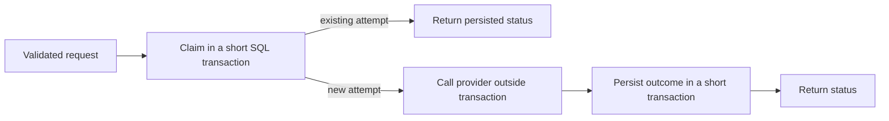

# Porting our Node backend to Elixir

This tutorial follows a working port of our booking API. The original Fastify backend remains in `apps/api`; the Elixir implementation lives in `apps/api-elixir`. The Expo web app can use either one. You can make the same booking twice, inspect the implementations side by side, and see which ideas carry across languages.

The goal is to translate the **behavior and boundaries** of the backend. We keep the routes, JSON contract, SQL schema, accepted pricing, and payment recovery rules. Elixir changes how we represent outcomes, organize functions, own mutable resources, and supervise running processes.

## 1. Run both implementations

You need Node 24, npm 11, and Elixir 1.18 or newer with a compatible Erlang/OTP installation. This port was verified with Elixir 1.20.4 and OTP 29. Use the [official installation guide](https://elixir-lang.org/install.html) for your platform; on macOS, `brew install elixir` installs both Elixir and Erlang.

From the repository root:

```sh
npm ci
npm run setup:elixir
npm run demo
```

Open [localhost:8082](http://localhost:8082). Pick **Node.js** or **Elixir** above the checkout. The demo starts Node on port 3002, Elixir on 3003, and one local payment simulator. Each backend gets a separate temporary SQLite database. Stop with Ctrl-C.

Use synthetic details: `Example`, `example@example.com`, and these cards:

| Card | Experiment |
| --- | --- |
| `4111 1111 1111 1111` | Place a successful booking with either backend. |
| `4111 1111 1111 0002` | See an explicit decline; change the card and retry. |
| `4111 1111 1111 0003` | A three-second payment: reload or switch away, then return. |

The picker remembers your selection in browser session storage. Switching resets the form and cancels its UI requests. A payment already accepted by the backend can still finish. Unfinished checkout IDs stay associated with the original backend, so returning can recover its result. Card details are never saved in browser storage.

See [demo orchestration](../e2e/demo.ts), [Elixir startup helper](../e2e/support/elixir.ts), [picker](../apps/web/App.tsx), and [backend URLs](../apps/web/src/api/config.ts).

For normal development, use three terminals:

```sh
npm run dev:api       # Node:   http://127.0.0.1:3000
npm run dev:elixir    # Elixir: http://127.0.0.1:3001
npm run dev:web      # Web:    http://localhost:8081
```

These development APIs use the supplied mock payment service. Only `demo` and browser tests replace it with our local simulator. API configuration is documented in the [Elixir README](../apps/api-elixir/README.md).

## 2. Start with the behavior we must preserve

The TypeScript schemas in [packages/contracts](../packages/contracts/src/index.ts) remain the web app's source of runtime validation. Elixir cannot import Zod, so [Bounce.Contracts](../apps/api-elixir/lib/bounce/contracts.ex) implements the input checks separately.

| Route | Behavior in both backends |
| --- | --- |
| `GET /health` | `{ "status": "ok" }` |
| `GET /stores/:storeId` | Current store name, currency, item price, and quantity bounds |
| `POST /checkout` | Validate, claim an attempt, call the provider, save the outcome |
| `GET /checkout/:checkoutId` | Read the latest attempt; stale processing becomes unknown |

Checkout responses use the same camelCase fields and the same four status strings: `succeeded`, `declined`, `processing`, `unknown`. A POST with processing or unknown returns HTTP 202; a status GET returns HTTP 200 when the checkout exists. Both checkout routes send `Cache-Control: no-store`. Public errors use `{ "error": { "code": "…", "message": "…" } }`.

The database schema is also the same. We package copies of the Node SQL migrations under Elixir's `priv/migrations`, which is included in releases. An [ExUnit test](../apps/api-elixir/test/checkout_test.exs) checks that the two directories match. Add future migrations to both directories.

**Shared schema does not mean shared booking state.** The default databases are separate, and request fingerprints have backend-specific encodings. Do not point both APIs at one booking database as a migration strategy. Sharing state would require agreeing on fingerprint encoding and testing cross-runtime ownership explicitly.

## 3. Map the files before learning the syntax

| Responsibility | Node implementation | Elixir implementation |
| --- | --- | --- |
| Build and launch HTTP server | [app.ts](../apps/api/src/app.ts), [server.ts](../apps/api/src/server.ts) | [application.ex](../apps/api-elixir/lib/bounce/application.ex) |
| Routes and public errors | [routes](../apps/api/src/routes) | [router.ex](../apps/api-elixir/lib/bounce/router.ex) |
| Runtime input validation | [Zod contracts](../packages/contracts/src/index.ts) | [contracts.ex](../apps/api-elixir/lib/bounce/contracts.ex) |
| Checkout orchestration | [services/checkout.ts](../apps/api/src/services/checkout.ts) | [checkout.ex](../apps/api-elixir/lib/bounce/checkout.ex) |
| Store queries | [repositories/stores.ts](../apps/api/src/repositories/stores.ts) | [stores.ex](../apps/api-elixir/lib/bounce/stores.ex) |
| Booking queries | [repositories/bookings.ts](../apps/api/src/repositories/bookings.ts) | [bookings.ex](../apps/api-elixir/lib/bounce/bookings.ex) |
| Connection and migrations | [database.ts](../apps/api/src/database.ts) | [database.ex](../apps/api-elixir/lib/bounce/database.ex) |
| Provider integration | [payments.ts](../apps/api/src/payments.ts) | [payments.ex](../apps/api-elixir/lib/bounce/payments.ex) |
| Package and runtime configuration | [package.json](../apps/api/package.json), environment variables | [mix.exs](../apps/api-elixir/mix.exs), [runtime.exs](../apps/api-elixir/config/runtime.exs) |

We chose Plug and Bandit for this small JSON API. Plug supplies the request pipeline; Bandit serves HTTP. Phoenix would be a reasonable next step if we needed its conventions, channels, or broader web features. Direct SQL keeps the persistence comparison visible; an Ecto-based port would also introduce repositories, schemas, and changesets. Those are useful tools, but they are another layer to learn.

## 4. Learn enough syntax to read a real module

In [stores.ex](../apps/api-elixir/lib/bounce/stores.ex), we use a module containing functions:

```elixir
defmodule Bounce.Stores do
  alias Bounce.Database, as: DB

  def get(db, store_id) do
    case DB.one(db, "SELECT id, name, currency FROM stores WHERE id = ?", [store_id]) do
      nil -> nil
      store ->
        # The full implementation loads the items here.
        Map.put(store, "checkoutItems", items)
    end
  end
end
```

This excerpt omits the item query; open the linked file for the complete executable function.

`defmodule` names a module. `def` creates a public function; `defp` creates a private function. The last expression is the result: there is no `return` statement. `do … end` brackets a body, while `do: expression` is a shorter spelling for simple bodies. `alias` gives a module a local name; it does not instantiate it. Our functions use `snake_case` internally, while JSON stays camelCase.

`get/2` means the function `get` with two arguments. Arity is part of a function's identity. This also explains captures such as `&Payments.process/1`, used as a default payment function in [checkout.ex](../apps/api-elixir/lib/bounce/checkout.ex).

### Maps, atoms, tuples, lists, and strings

```elixir
%{"status" => "processing"}  # map with a JSON-style string key
%{status: "processing"}      # map with atom key :status
{:ok, 1180}                 # tuple: fixed-size, positional values
[%{"itemId" => "bag"}]      # list
"USD"                       # UTF-8 string
```

An atom such as `:ok` is a named constant. `%{status: value}` is shorthand for `%{:status => value}`. A string-keyed map is accessed with `map["status"]`; `data.status` accesses an atom key and expects it to exist.

Our JSON decoder produces string keys. The boundary validator constructs a small internal atom-keyed map itself. We never convert arbitrary incoming keys into atoms. That keeps the internal vocabulary under our control.

Tuples carry outcomes, such as `{:declined, "CARD_DECLINED"}`. Lists carry collections, such as checkout items. Unlike JavaScript, `{…}` is a tuple; `%{…}` is the map syntax. Single-quoted text is a charlist, not the normal string syntax; the port uses double quotes for text.

Read the official [basic types](https://hexdocs.pm/elixir/basic-types.html) and [maps and keyword lists](https://hexdocs.pm/elixir/keywords-and-maps.html) guides.

### Immutability and transformations

Node constructs a response using an object spread:

```ts
return storeSchema.parse({ ...store, checkoutItems });
```

Elixir constructs a new map:

```elixir
Map.put(store, "checkoutItems", items)
```

The original `store` value does not change. Variables can be rebound to new values, but the data itself is immutable. This makes transformations local and easier to reason about. It does not make a database immutable: SQLite remains an external mutable resource.

In [bookings.ex](../apps/api-elixir/lib/bounce/bookings.ex), the equivalent of JavaScript's `.map` is:

```elixir
items = Enum.map(data.items, &Map.put(&1, "unitPriceCents", unit_price))
```

`&1` represents the first argument of the captured anonymous function. The longer form is:

```elixir
items = Enum.map(data.items, fn item ->
  Map.put(item, "unitPriceCents", unit_price)
end)
```

Named functions use `Module.function(argument)`; anonymous functions use `function.(argument)`. The dot in `pay.(input)` in our checkout service is significant. See [anonymous functions](https://hexdocs.pm/elixir/anonymous-functions.html).

### Pattern matching instead of repeated field checks

Node represents payment results with a discriminated union:

```ts
type PaymentResult =
  | { status: 'succeeded'; transaction: Transaction }
  | { status: 'declined'; errorCode: string }
  | { status: 'unknown'; errorCode?: string };
```

Our [Elixir booking repository](../apps/api-elixir/lib/bounce/bookings.ex) matches tagged tuples:

```elixir
{status, transaction, error_code} =
  case result do
    {:succeeded, transaction} -> {"succeeded", transaction, nil}
    {:declined, code} -> {"declined", nil, code}
    {:unknown, code} -> {"unknown", nil, code}
  end
```

`case` selects the first matching shape and binds its fields. `=` also matches: `{:ok, db} = Sqlite3.open(path)` means that startup requires the success shape. An unexpected shape raises a match error. At the public JSON boundary, we handle invalid input as a normal error result instead.

`[item] = store["checkoutItems"]` asserts exactly one item. A map pattern matches required keys and can accept additional keys. `_` discards a value. To match a previously bound variable's value, use a pin such as `^expected`.

Try the [pattern matching guide](https://hexdocs.pm/elixir/pattern-matching.html) with IEx open beside the repository.

## 5. Translate Zod validation into a boundary function

Our Node route calls `checkoutRequestSchema.safeParse(request.body)`. It gets a success flag plus normalized data, or an error. [Bounce.Contracts.checkout/1](../apps/api-elixir/lib/bounce/contracts.ex) returns `{:ok, data}` or `{:error, :invalid_checkout}`.

The first function clause requires the expected request structure:

```elixir
# Abbreviated from Bounce.Contracts.checkout/1.
def checkout(%{"name" => name, "email" => email, "cardNumber" => card} = body)
    when is_binary(name) and is_binary(email) and is_binary(card) do
  # The implementation also requires IDs, one bag item, pricing, and currency.
end

def checkout(_), do: {:error, :invalid_checkout}
```

Function clauses are tried in order. `when` introduces a guard; guards support a restricted set of checks that can safely determine whether a clause applies. After structural matching, our implementation trims name/email, strips spaces from card digits, and validates UUIDs, quantities, totals, currency, email, and card shape.

The returned internal map uses `checkout_id` and `card_number`, but the response encoder still emits `checkoutId` and `attemptId`. Language conventions stay inside the service; the wire contract stays stable.

Our router connects validation to processing with `with`:

```elixir
with {:ok, data} <- Contracts.checkout(conn.body_params) do
  # Process the validated checkout; the real route catches CheckoutError too.
else
  _ -> error(conn, 400, "INVALID_CHECKOUT", "Invalid checkout details.")
end
```

`<-` accepts only the matching result; a nonmatching value goes to `else`. This keeps the successful path readable. The snippets above are teaching excerpts, not alternate implementations to paste over the full validator. See [with](https://hexdocs.pm/elixir/Kernel.SpecialForms.html#with/1) and [guards](https://hexdocs.pm/elixir/patterns-and-guards.html).

Elixir is dynamically typed. Pattern matching, guards, and optional `@spec` annotations do not replace runtime validation. TypeScript also needs runtime validation when JSON enters from outside its type system. Maintaining two validators is a cost of this coexistence approach; our tests cover malformed input and exercise both backends through the same browser flow.

## 6. Translate Fastify handlers into a Plug pipeline

Compare [Node's store route](../apps/api/src/routes/stores.ts) with [Bounce.Router](../apps/api-elixir/lib/bounce/router.ex).

```ts
app.get('/stores/:storeId', async (request, reply) => {
  // Validate request.params, load the store, and reply.
});
```

```elixir
get "/stores/:store_id" do
  # Validate store_id, load the store, and return a connection.
end
```

The route syntax comes from `use Plug.Router`, which brings in routing macros. `use GenServer` similarly sets up an OTP behavior. These are compile-time facilities; they are not inheritance from a class. `import Plug.Conn` makes functions available without their module prefix, while `alias` only shortens a module name.

The actual router pipeline is:

```elixir
plug :configure
plug :cors
plug :match
plug Plug.Parsers, parsers: [:json], pass: [], json_decoder: Jason, length: 1_048_576
plug :dispatch
```

The order matters: attach dependencies, handle CORS/preflight, find a route, parse the body, and dispatch. `conn` is a `Plug.Conn` struct, a map with a known set of connection fields. Our response helper uses a pipe:

```elixir
conn
|> put_resp_content_type("application/json")
|> send_resp(status, Jason.encode!(body))
```

`|>` inserts the previous result as the next call's first argument. Each call returns a connection value for the next step. The pipeline expresses data flow; it does not mean “run in parallel.” Learn more in [Plug.Router](https://hexdocs.pm/plug/Plug.Router.html) and [Plug.Conn](https://hexdocs.pm/plug/Plug.Conn.html).

## 7. Preserve the checkout state machine

Read [the Node service](../apps/api/src/services/checkout.ts) and [Bounce.Checkout](../apps/api-elixir/lib/bounce/checkout.ex) together. Both follow this sequence:



The claim checks existing IDs before checking current store prices. A replay of accepted terms must recover the original result even if today's price changed. IDs reused with different customer/item/price details produce a conflict. New payments use the server's price and quantity bounds, not a client-calculated total alone.

The Elixir branch point is:

```elixir
case Database.transaction(database, &claim(&1, data)) do
  {:replay, response} -> response
  {:start, amount, currency} ->
    # Call pay.(input), then persist the outcome.
end
```

The private `claim/2` uses `cond` for ordered conditions. `case` selects by shape; `cond` selects the first truthy condition. In Elixir only `false` and `nil` are falsy: `0`, `""`, and `[]` are truthy. Watch this when translating JavaScript conditionals.

The important rules are unchanged:

| Previous outcome | Reusing the same attempt | New attempt for the same checkout |
| --- | --- | --- |
| `processing` | Return processing, or unknown if stale | Recover the existing attempt |
| `succeeded` | Return succeeded | Recover the existing attempt |
| `declined` | Return declined | A new deliberate payment is allowed |
| `unknown` | Return unknown | Recover the existing attempt |

Twenty seconds after an unresolved attempt was created, a status read can mark it unknown. This does not prove the provider did not charge. A late definitive result can still be saved. A provider success followed by a database save failure becomes unknown, so another request cannot silently charge again.

The signature excludes the card number and any card hash. A changed card after a decline uses a new attempt ID; it does not change the booking's accepted customer and pricing details. Both implementations use integer cents, and Elixir retains JavaScript's safe-integer bound at the public boundary so the web client can represent values reliably.

Supervision and idempotency solve different problems. Restarting a failed process cannot undo an external payment. The provider still has no documented idempotency, lookup, or reconciliation API; this port does not produce an exactly-once guarantee.

## 8. Put database ownership in a GenServer

Node uses a synchronous `better-sqlite3` connection. Elixir has many request processes, so we give one process ownership of the SQLite connection. [Bounce.Database](../apps/api-elixir/lib/bounce/database.ex) is that process.

```elixir
def run(server, operation) do
  case GenServer.call(server, {:run, operation}, 10_000) do
    {:ok, value} -> value
    {:error, exception, stacktrace} -> reraise exception, stacktrace
  end
end
```

`GenServer.call` sends a message and waits for a reply. `handle_call/3` executes the operation using the connection stored as its state, then returns `{:reply, result, db}`. The connection stays private to the owner. Domain/database exceptions are returned and re-raised in the caller, so a routine checkout rejection does not crash the connection owner.

Only short SQL work runs there. The provider call runs in the request process, with a task handling its HTTP deadline. Otherwise a slow payment would serialize every store read, status read, and booking behind it. Our concurrent replay test holds a payment open and verifies those reads still complete.

The transaction helper issues `BEGIN IMMEDIATE`, calls the operation, commits, and rolls back on exceptions. That preserves the existing SQLite locking semantics. The GenServer serializes one instance's access; SQL constraints and transactions also protect the file. It is not a distributed lock.

A BEAM process is a lightweight runtime process with a mailbox, not an operating-system process or a JavaScript Promise. Processes communicate by messages and do not expose a shared mutable JavaScript heap. Here `database` can be a process identifier in tests or the registered name `Bounce.Database` in the running application. See [GenServer](https://hexdocs.pm/elixir/GenServer.html) and [processes](https://hexdocs.pm/elixir/processes.html).

This owner is deliberately simple and can become a bottleneck under database-heavy traffic. Elixir's concurrency cannot remove SQLite's single-writer limit. A production expansion might use Ecto, pooled database access, and PostgreSQL after measuring contention.

## 9. Translate await and timeouts without changing payment semantics

Node's [adapter](../apps/api/src/payments.ts) awaits `fetch` with a 15-second abort signal. Elixir's [adapter](../apps/api-elixir/lib/bounce/payments.ex) calls Req in a task:

```elixir
task = Task.Supervisor.async_nolink(Bounce.PaymentTasks, fn -> request(input) end)

case Task.yield(task, @timeout_ms) || Task.shutdown(task, :brutal_kill) do
  {:ok, result} -> result
  _ -> {:unknown, "PROVIDER_TIMEOUT"}
end
```

`@timeout_ms` is a module attribute. `async_nolink` keeps a worker failure from taking down the caller through a task link. `Task.yield` waits for the bounded result. The surrounding deadline covers the whole request task, including response processing; the connection and receive timeouts are additional limits. Killing the local worker cannot cancel a charge already accepted by the provider.

Req ordinarily has retry behavior. Our request explicitly uses `retry: false` and `redirect: false`. A transport failure becomes unknown; there is no automatic second payment. Success also requires matching amount, currency, card suffix, and transaction metadata. Only documented declines permit a fresh deliberate attempt. Extra provider fields are stripped before persistence.

The function call looks synchronous inside one Elixir request process. Other BEAM processes can still progress while it waits. This changes the concurrency model; it does not make external I/O instantaneous or remove the need for deadlines. Read [Task.Supervisor](https://hexdocs.pm/elixir/Task.Supervisor.html) and [Req's request options](https://hexdocs.pm/req/Req.html).

## 10. Use supervision for lifecycle, not business retries

Node's [server.ts](../apps/api/src/server.ts) explicitly starts Fastify and closes it on termination signals. Elixir's [Application](../apps/api-elixir/lib/bounce/application.ex) starts a supervision tree:

```text
Bounce.Supervisor (:rest_for_one)
├── Bounce.PaymentTasks (Task.Supervisor)
├── Bounce.Database    (SQLite owner)
└── Bandit             (HTTP server)
```

`:rest_for_one` restarts a failed child and the children started after it. Database failure therefore restarts the HTTP server after the connection has been reopened and migrations checked. Children are stopped in reverse order on normal shutdown. The tree expresses dependencies; supervisors restart child processes, not checkout business operations. They never replay a payment request for us.

`@impl true` marks a callback supplied for a behavior such as `Application` or `GenServer`, allowing the compiler to check that intent. Functions such as `start/2`, `init/1`, and `handle_call/3` are the lifecycle hooks OTP invokes. Ordinary modules such as `Bounce.Stores` are collections of functions and do not need their own process.

This makes failure isolation and restart policy explicit. It is a substantial Elixir benefit for long-running systems, but recovery still depends on durable state and careful handling of in-flight work. See [Supervisor](https://hexdocs.pm/elixir/Supervisor.html) and [Bandit](https://hexdocs.pm/bandit/Bandit.html).

## 11. Build, test, and explore interactively

`mix.exs` plays the package/build role of `package.json`; `mix.lock` pins dependency versions. `.ex` files contain compiled modules, while `.exs` files are scripts used for configuration and tests. `config/runtime.exs` reads environment configuration at boot, rather than baking deployment-specific values into compiled modules.

```sh
npm run check         # Existing TypeScript checks, lint, Jest
npm run check:elixir  # mix format, strict compilation, ExUnit
npm run test:e2e      # The same browser scenarios against both real APIs
npm run build        # TypeScript API and web export

cd apps/api-elixir
MIX_ENV=prod mix release
```

The standalone release includes the packaged SQL migrations. `PORT=3001 WEB_ORIGIN=http://localhost:8081 _build/prod/rel/bounce/bin/bounce start` starts it with runtime configuration. The release must be built for the target operating system and architecture; Exqlite includes native code.

[ExUnit tests](../apps/api-elixir/test) use real isolated SQLite databases and inject a payment function where business behavior is the subject. [Payment adapter tests](../apps/api-elixir/test/payments_test.exs) also exercise real local HTTP. [Browser tests](../e2e/checkout.spec.ts) cover persisted pricing, decline retry, reload recovery, and [switching during a pending payment](../e2e/backends.spec.ts). Only the external provider is simulated in browser tests.

ExUnit's `assert` can pattern match. `assert_receive` checks process messages, which lets a test hold the provider until it has inspected the in-flight state. `async: true` runs independent tests concurrently; tests changing application-wide provider configuration use `async: false`. Read [ExUnit](https://hexdocs.pm/ex_unit/ExUnit.html).

Try IEx without opening an HTTP port:

```sh
cd apps/api-elixir
MIX_ENV=test iex -S mix
```

```elixir
alias Bounce.{Database, Stores}
{:ok, db} = Database.start_link(path: ":memory:")
Database.run(db, &Stores.get(&1, "codys-cookie-store"))
h Bounce.Database.run/2
GenServer.stop(db)
```

`h` opens function documentation. Use the [syntax reference](elixir-syntax-reference.md) as you read the modules. IEx is especially useful for trying matches and transformations before changing the service.

## 12. Benefits, costs, and what to do next

| Choice | Benefit in this port | Cost or limitation |
| --- | --- | --- |
| Tagged tuples and pattern matching | Outcomes and required input shapes are visible in control flow | New syntax; patterns are not full schemas or static types |
| Immutable values | Transformations do not mutate another caller's data | Resource ownership still needs design |
| BEAM processes and OTP supervision | Concurrent request work and explicit failure recovery | Mailboxes, timeouts, and dependency order require understanding |
| Direct SQL plus one connection owner | Easy comparison with existing repositories and migrations | Serial database access and SQLite writer contention |
| Plug instead of a generated Phoenix application | Small surface focused on the existing JSON API | Fewer conventions and facilities included by default |
| Two independently deployable backends | Incremental exploration; Node keeps working | Two runtimes, validators, lockfiles, and migration copies to maintain |
| Same React client and HTTP contract | Visible comparison without rewriting the interface | TypeScript contracts are not compiled into Elixir |

Elixir is attractive when a service grows toward many concurrent connections, background work, and long-running process coordination. Node remains a strong fit for the existing TypeScript stack and its tooling. This repository has not benchmarked throughput or latency; no performance improvement is claimed. The current booking flow alone does not require replacing Node.

Next exercises, in increasing difficulty:

1. Change a store's price in an isolated test. Trace `PRICE_CHANGED` from SQL through the service and router to the existing web form.
2. Add a different provider decline fixture. Follow its tagged tuple into the persisted attempt and verify that the same ID is replayed.
3. Add `@spec` annotations to the checkout and repository functions. Explain which errors still require runtime checks; optionally introduce Dialyzer separately.
4. Add a new catalog field to both contracts and both repositories. Use browser validation to catch a missing field in either backend.
5. Sketch an Ecto/PostgreSQL implementation while keeping the claim → provider → persist boundary. Decide which transaction/uniqueness guarantees must survive.

For the first pass, read **Contracts → Router → Checkout → Bookings → Database → Application**, with the Node equivalent open beside each file. The payment adapter can be read independently once the three payment outcomes are familiar.
